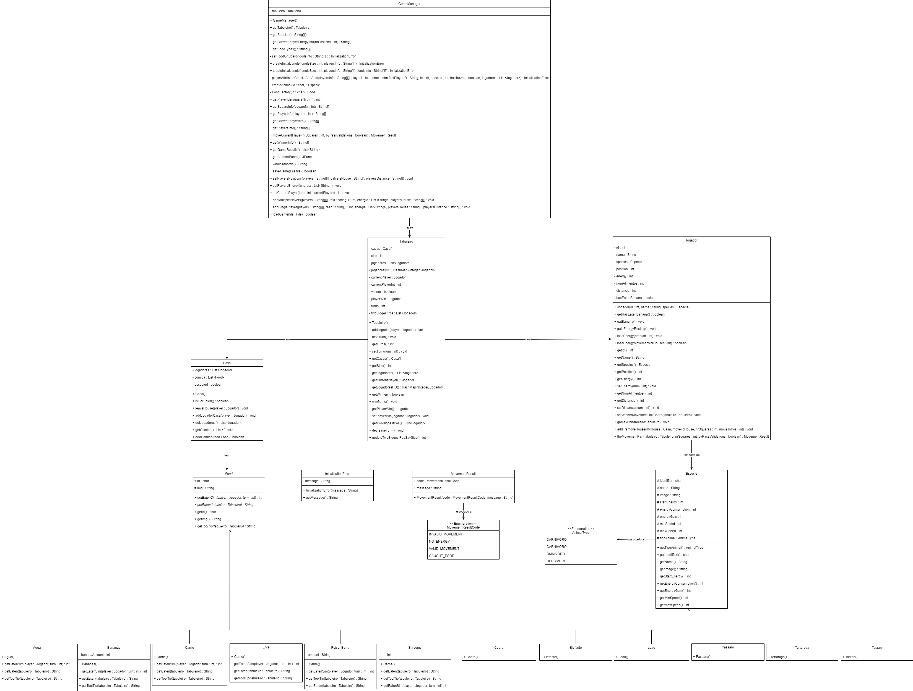

# LP2Projeto
Adicionamos uma espécie que se chama "Cobra" e tem uma imagem que se chama "snake.png", tal como uma classe "PoisonBerry", que é comida que pode ser ingerida pelos Jogadores, com a imagem "poisonBerry.png".
Também foi mudada a página dos créditos.

